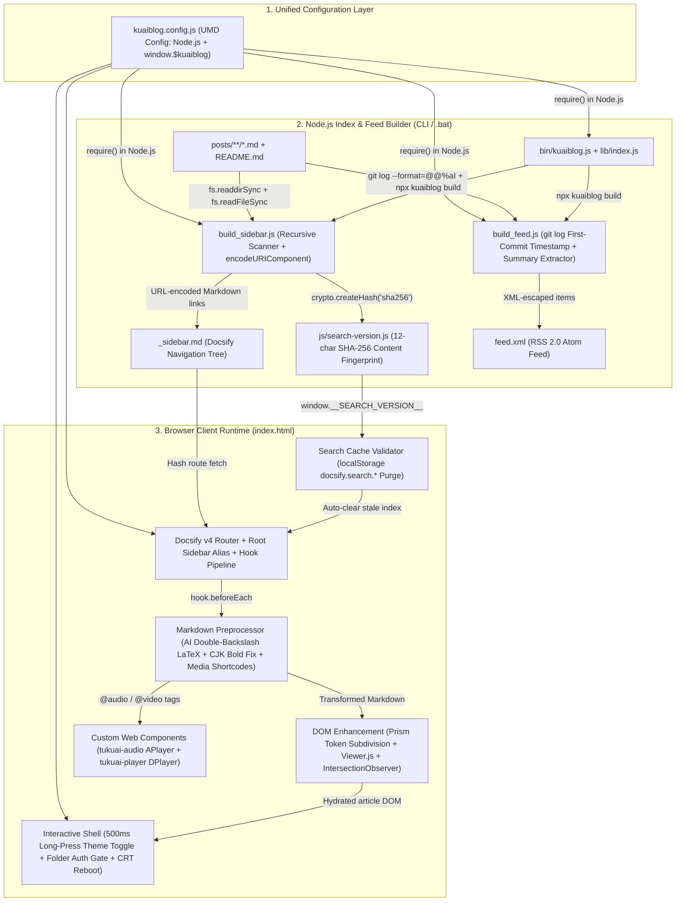

English | [简体中文](README.zh-CN.md)

# KuaiBlog

**KuaiBlog** (`kuaiblog`) is a zero-bundler Docsify Markdown blog and knowledge-base engine that transforms a plain folder of `.md` articles into a full-featured static site with **Geek Dark** & **Pastel Light** themes, IDE-grade syntax highlighting, MathJax LaTeX, Mermaid 12 diagrams, APlayer/DPlayer media Web Components, and SHA-256 search cache invalidation.

---

## Architecture & Data Flow



---

## End-to-End Flow & Core Technologies

| Stage | Data Flow (From -> To) | Core Technologies | What It Accomplishes |
| :--- | :--- | :--- | :--- |
| **1. Workspace Scaffolding & Config** | `template/*` -> User blog directory + `kuaiblog.config.js` | Node.js `fs.copyFileSync`, UMD module export (`module.exports` / `window.$kuaiblog`) | Initializes a self-contained static blog workspace where both Node.js build scripts and the browser runtime share a single configuration file without bundlers. |
| **2. Sidebar & Search Fingerprint Generation** | `posts/**/*.md` + `README.md` -> `_sidebar.md` + `js/search-version.js` | Recursive directory traversal, per-segment `encodeURIComponent`, `crypto.createHash('sha256')` | Generates a nested Markdown sidebar supporting spaces, emojis, and CJK paths, and computes a deterministic 12-character SHA-256 fingerprint of all article contents. |
| **3. RSS 2.0 Feed Construction** | `posts/**/*.md` + `.git` history -> `feed.xml` | `child_process.execFileSync('git')`, Markdown AST-free paragraph summarizer, XML entity escaping, RSS `<image>` channel icon | Extracts each post's H1 title, first-commit timestamp (`git log --format=@@%aI` with `mtime` fallback), and plain-text summary while excluding private directories. |
| **4. Search Cache & Route Aliasing** | `js/search-version.js` + `_sidebar.md` -> Browser `localStorage` & Router | `window.__SEARCH_VERSION__`, `localStorage` key prefix scanning (`docsify.search.*`), Docsify `alias` (`/.*/_sidebar.md` -> `/_sidebar.md`) | Purges stale Docsify full-text search indexes automatically when content hashes change, and routes nested folder navigation to the root `_sidebar.md` without 404 requests. |
| **5. Markdown Preprocessing & Media Hydration** | Raw `.md` response -> Docsify `hook.beforeEach` -> Custom Elements | Regex AST-aware code skipping, Web Components (`<tukuai-audio>`, `<tukuai-player>`), APlayer, DPlayer, `navigator.mediaSession` | Normalizes double-escaped LaTeX (`\\[...\\]`, `\\(...\\)`), fixes CJK punctuation bolding edge cases, and mounts audio/video players with automatic `disconnectedCallback()` teardown on route change. |
| **6. Post-Render DOM & Theme Engine** | Rendered `.markdown-section` -> `hook.doneEach` -> Interactive UI | Prism.js token classification (`token-type`, `token-control`), MathJax (`tex-mml-svg.js`), Mermaid 12.2.0, Viewer.js, `IntersectionObserver`, Pointer Events | Applies IDE-grade syntax coloring, wraps responsive tables, binds image lightbox zoom, animates scroll reveal, enforces session-based folder password locks, and toggles Geek Dark / Pastel Light themes via a 500ms pointer long-press. |

---

## Directory Structure

```text
kuaiblog/
├── package.json                  # npm package manifest and CLI bin registration
├── bin/
│   └── kuaiblog.js               # CLI entry point (init, build, serve)
├── lib/
│   └── index.js                  # Core Node.js implementation for scaffolding, building, and local dev server
└── template/                     # Blog workspace template copied by `npx kuaiblog init`
    ├── index.html                # Docsify runtime shell, dual-theme CSS variables, and plugin pipeline
    ├── site.webmanifest          # PWA Web App Manifest with 192x192 and 512x512 icon declarations
    ├── favicon.ico               # Root multi-size browser icon for zero-404 `/favicon.ico` lookup
    ├── kuaiblog.config.js        # Unified UMD configuration shared by Node.js scripts and browser runtime
    ├── build_sidebar.js          # Standalone sidebar and SHA-256 search fingerprint generator
    ├── build_feed.js             # Standalone RSS 2.0 feed generator
    ├── refresh_sidebar.bat       # Windows one-click batch script to refresh sidebar and RSS feed
    ├── README.md                 # Default homepage featuring the interactive HELLO WORLD pioneer mosaic
    ├── posts/
    │   └── Getting-Started.md    # Starter Markdown article demonstrating syntax, math, diagrams, and media tags
    ├── css/                      # Local stylesheets (home, vue, prism-vsc-dark-plus, APlayer, DPlayer, Viewer, Mermaid)
    ├── js/                       # Local engines (Docsify 4, MathJax, Mermaid 12, Chart.js, D3 v7, Spectral, Web Components)
    ├── favicon/                  # Default site icons and OpenGraph cover assets
    └── media/
        └── hw-cell.svg           # Grid cell vector asset for the homepage HELLO WORLD mosaic
```

---

## Quick Start & CLI Commands

### 1. Initialize a New Blog

Run `npx kuaiblog init` inside an empty folder (or pass a target directory name):

```bash
npx kuaiblog init my-blog
cd my-blog
```

### 2. Write Markdown Articles

Place your `.md` files and subfolders inside the `posts/` directory (or whatever directory name you set in `contentDir` inside `kuaiblog.config.js`).

### 3. Refresh Sidebar & RSS Feed

Whenever you add, rename, or delete Markdown files, run:

```bash
npx kuaiblog build
```

### 4. Local Preview Server

Start a local static server with automatic sidebar regeneration when files in `posts/` change:

```bash
npx kuaiblog serve --port 3000
```

---

## Windows One-Click Sidebar Refresh (`.bat` Guide)

On Windows, you do not need to open a terminal and type commands every time you add or rename an article. You can use a `.bat` batch file to refresh `_sidebar.md`, `js/search-version.js`, and `feed.xml` with a single double-click.

### 1. Built-In `refresh_sidebar.bat`

When you run `npx kuaiblog init`, a ready-to-use `refresh_sidebar.bat` file is automatically created in your blog's root directory.

### 2. How to Write the `.bat` File Manually

If you ever want to create or customize this batch script yourself:

1. Right-click inside your blog's root folder (the same folder that contains `index.html`, `build_sidebar.js`, and `build_feed.js`).
2. Select **New -> Text Document**, and rename it to `refresh_sidebar.bat` (make sure the file extension is `.bat` and not `.bat.txt`).
3. Right-click `refresh_sidebar.bat`, click **Edit** (or open with Notepad / VS Code), paste the following script, and save it with **UTF-8** encoding:

```bat
@echo off
chcp 65001 >nul
cd /d "%~dp0"

echo ===================================================
echo   [KuaiBlog] Refreshing _sidebar.md and feed.xml...
echo ===================================================
echo.

node build_sidebar.js
node build_feed.js

echo.
echo ===================================================
echo   Done! Press any key to close this window...
echo ===================================================
pause >nul
```

#### What Each Line Does:
- `@echo off`: Hides the raw command prompt strings so the console output stays clean.
- `chcp 65001 >nul`: Switches the Windows command prompt code page to UTF-8 so Unicode symbols and non-ASCII folder names print without garbled characters.
- `cd /d "%~dp0"`: Automatically changes the working directory to the exact folder where the `.bat` file resides (even if you launch it via a Desktop shortcut or across different drive letters like `C:` and `D:`).
- `node build_sidebar.js`: Scans your `contentDir` folder, URL-encodes all file paths into `_sidebar.md`, and updates the SHA-256 search cache fingerprint in `js/search-version.js`.
- `node build_feed.js`: Regenerates the RSS 2.0 `feed.xml` file from your latest articles.
- `pause >nul`: Keeps the console window open after completion so you can verify the article count before pressing any key to exit.

> **Alternative using `npx`**: If you prefer not to keep `build_sidebar.js` and `build_feed.js` in your root folder, you can replace the two `node ...` lines in the `.bat` file with `call npx kuaiblog build`.

### 3. How to Use It

1. Make sure [Node.js](https://nodejs.org/) (v16 or newer) is installed on your Windows machine.
2. Add, edit, rename, or move your `.md` articles inside your `posts/` folder.
3. **Double-click `refresh_sidebar.bat`** in Windows File Explorer.
4. Wait about 1 second until the window displays `Updated _sidebar.md` and `Done! Press any key to close this window...`, then press any key to close it.
5. *(Optional Tip)* Right-click `refresh_sidebar.bat` and select **Send to -> Desktop (create shortcut)** so you can refresh your blog directory directly from your Windows Desktop.

---

## Configuration (`kuaiblog.config.js`)

All site settings live in `kuaiblog.config.js` at the root of your blog:

```javascript
module.exports = {
    title: 'KuaiBlog',
    description: 'A Geek-Dark & Pastel-Light Docsify blog engine.',
    siteUrl: 'https://example.com/',

    // Folder where your Markdown posts are stored
    contentDir: 'posts',
    homeLabel: 'Home',
    homeFile: 'README.md',

    // Sidebar header & theme settings
    sidebarTitle: 'Experience more.',
    rebootRedirectUrl: '', // External URL to open after CRT shutdown animation (empty = return to home)
    defaultTheme: 'dark',  // 'dark' | 'light'

    // Full-text search settings
    search: {
        placeholder: '🔍 Search articles...',
        noData: '😭 No matching results found!',
        depth: 6
    },

    // Client-side password lock for private folders
    auth: {
        enable: false,
        lockedDirKeyword: 'Private',
        password: '123456',
        title: 'Private Space',
        description: 'Please enter the access code to unlock this area',
        placeholder: 'Password',
        buttonText: 'Unlock',
        errorText: 'Incorrect password, please try again'
    },

    // RSS 2.0 feed settings
    rss: {
        enable: true,
        outputFile: 'feed.xml',
        maxItems: 30,
        language: 'en-US',
        excludeDirs: ['Private']
    }
};
```

---

## Built-In Features & Recommended Markdown Syntax

### 1. Video Player (`<tukuai-player>`)
Use the `<tukuai-player>` custom component in your Markdown articles (supports setting `title` for the built-in camera snapshot download filename):

```html
<tukuai-player url="media/videos/XXX.mp4" title="XXX"></tukuai-player>
```
> *Shortcode alternative*: `@[video](media/videos/XXX.mp4)` (quick syntax when custom snapshot title is not needed).

### 2. Audio Player (`<tukuai-audio>`)
Use the `<tukuai-audio>` custom component for APlayer music cards with system MediaSession lock-screen controls and automatic route-leave cleanup:

```html
<tukuai-audio
  url="media/music/XXX.mp3"
  name="Track Title"
  artist="Artist Name"
  cover="media/music/XXX.png">
</tukuai-audio>
```
> *Shortcode alternative*: `@[audio](media/music/XXX.mp3, Track Title, Artist Name, media/music/XXX.png)`

### 3. Images & Path Resolution Rules (``)
Use standard Markdown image syntax (automatically enhanced with Viewer.js zoomable lightbox gallery on click):

```markdown

```

> **Important Note on Relative Paths (`media/...` vs `../../media/...`)**:
> - **HTML Custom Tags (`<tukuai-player>` / `<tukuai-audio>`)** resolve `url` and `cover` relative to the root `index.html`, so always start directly with `media/videos/XXX.mp4` or `media/music/XXX.mp3`.
> - **Standard Markdown Images (``)** are resolved by Docsify relative to the **current `.md` article's subfolder depth**. For example, if your article is two levels deep (such as `posts/category/my-post.md`), prefix the path with `../../media/XXX.jpg` to step back to the root `media/` folder (or `../media/XXX.jpg` if the article is directly under `posts/my-post.md`).

### 4. Dual Themes, Math & Offline Visualization
- **Dual Theme Long-Press Toggle**: Click the bottom-right floating circle button (`.sidebar-toggle`) to collapse/expand the sidebar; **long-press it for 500ms** to switch between **Geek Dark** and **Pastel Light** themes.
- **LaTeX Mathematics**: Supports `$...$`, `$$...$$`, `\(...\)`, `\[...\]`, and automatically normalizes double-escaped `\\(...\\)` / `\\[...\\]` copied from AI assistants.
- **Mermaid Diagrams & Data Visualization**: Bundled with offline Mermaid 12.2.0, Chart.js, D3.js v7, and Spectral.js.

---

## License

MIT
