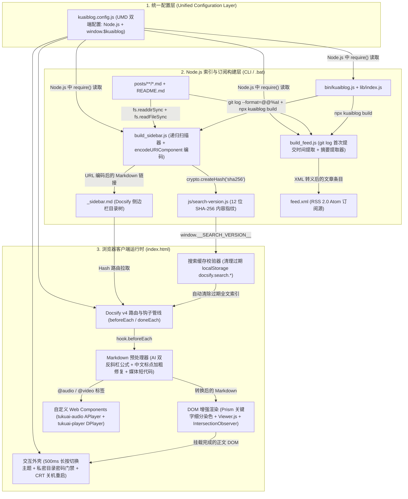

[English](README.md) | 简体中文

# KuaiBlog

**KuaiBlog** (`kuaiblog`) 是一款免打包构建的 Docsify Markdown 博客与知识库引擎，可将纯 `.md` 文章文件夹一键转化为具备**极客暗黑 (Geek Dark)** 与**温柔幻彩 (Pastel Light)** 双主题、IDE 级语法高亮、MathJax 数学公式、Mermaid 12 流程图、APlayer/DPlayer 音视频 Web Components 以及 SHA-256 搜索缓存自动刷新机制的完整静态站点。

---

## 全链路架构与数据流转图



---

## 分阶段流程与核心技术栈

| 阶段 | 数据流向（从哪到哪） | 采用的核心专业技术 | 具体完成的工作 |
| :--- | :--- | :--- | :--- |
| **1. 博客脚手架初始化与统一配置** | `template/*` -> 用户博客目录 + `kuaiblog.config.js` | Node.js `fs.copyFileSync`、UMD 双端模块导出 (`module.exports` / `window.$kuaiblog`) | 初始化自包含的静态博客工作区，使 Node.js 构建脚本与浏览器前端运行时直接共享同一份配置文件，无需任何打包器。 |
| **2. 侧边栏目录树与搜索指纹生成** | `posts/**/*.md` + `README.md` -> `_sidebar.md` + `js/search-version.js` | 递归目录遍历、逐段路径 `encodeURIComponent` 编码、`crypto.createHash('sha256')` | 生成支持空格、Emoji 与中文路径的多级 Markdown 侧边栏，并对全站文章内容计算确定性的 12 位 SHA-256 指纹。 |
| **3. RSS 2.0 订阅源构建** | `posts/**/*.md` + `.git` 历史 -> `feed.xml` | `child_process.execFileSync('git')`、免 AST 正文首段摘要提取、XML 实体转义 | 自动提取每篇文章的 H1 标题、Git 首次提交时间戳（`git log --format=@@%aI`，无 Git 时回退至 `mtime`）及纯文本摘要，并跳过私密目录。 |
| **4. 全文搜索缓存联动校验** | `js/search-version.js` -> 浏览器 `localStorage` | `window.__SEARCH_VERSION__`、`localStorage` 键名前缀扫描 (`docsify.search.*`) | 页面加载时对比最新内容指纹与 `localStorage.getItem('site_search_version')`，若文章发生增删改则自动清空旧的 Docsify 搜索缓存。 |
| **5. Markdown 预处理与音视频挂载** | 原始 `.md` 文本 -> Docsify `hook.beforeEach` -> Custom Elements | 跳过代码块的正则替换、Web Components (`<tukuai-audio>`, `<tukuai-player>`)、APlayer、DPlayer、`navigator.mediaSession` | 自动还原从 AI 复制的双反斜杠公式（`\\[...\\]`、`\\(...\\)`），修复中文标点紧贴加粗失效问题，并在切页时通过 `disconnectedCallback()` 自动销毁音视频实例防止背景音残留。 |
| **6. 渲染后 DOM 增强与双主题引擎** | `.markdown-section` -> `hook.doneEach` -> 交互 UI | Prism.js 词法细分染色 (`token-type`, `token-control`)、MathJax (`tex-mml-svg.js`)、Mermaid 12.2.0、Viewer.js、`IntersectionObserver`、Pointer Events | 执行 IDE 级数据类型/控制流关键字着色、移动端响应式表格包裹、图片灯箱缩放、滚动渐显动画、基于 `sessionStorage` 的私密目录密码锁，以及长按右下角圆点 500ms 切换极客暗黑/温柔幻彩主题。 |

---

## 目录结构

```text
kuaiblog/
├── package.json                  # npm 包清单与 CLI 命令 (bin) 注册
├── bin/
│   └── kuaiblog.js               # CLI 命令行入口 (支持 init, build, serve)
├── lib/
│   └── index.js                  # 脚手架初始化、目录/RSS 构建与本地预览服务器的核心实现
└── template/                     # 执行 `npx kuaiblog init` 时复制到用户目录的博客模板
    ├── index.html                # Docsify 运行时外壳、双主题 CSS 变量系统与插件管线
    ├── kuaiblog.config.js        # Node.js 脚本与浏览器运行时共享的 UMD 统一配置文件
    ├── build_sidebar.js          # 独立可运行的侧边栏生成与 SHA-256 搜索指纹更新脚本
    ├── build_feed.js             # 独立可运行的 RSS 2.0 订阅源生成脚本
    ├── refresh_sidebar.bat       # Windows 一键刷新侧边栏与 RSS 的批处理脚本
    ├── README.md                 # 默认博客首页（内置交互式 HELLO WORLD 计算机先驱拼图墙）
    ├── posts/
    │   └── Getting-Started.md    # 示例 Markdown 文章（演示代码高亮、公式、流程图与音视频标签）
    ├── css/                      # 本地样式表 (home, vue, prism-vsc-dark-plus, APlayer, DPlayer, Viewer, Mermaid)
    ├── js/                       # 本地引擎库 (Docsify 4, MathJax, Mermaid 12, Chart.js, D3 v7, Spectral, Web Components)
    ├── favicon/                  # 默认站点图标与 OpenGraph 封面资源
    └── media/
        └── hw-cell.svg           # 首页 HELLO WORLD 拼图墙空白格矢量占位资源
```

---

## 快速上手与 CLI 命令

### 1. 初始化新博客

在空白目录下运行 `npx kuaiblog init`（或指定目标文件夹名称）：

```bash
npx kuaiblog init my-blog
cd my-blog
```

### 2. 撰写 Markdown 文章

直接把你的 `.md` 文章和子文件夹放进 `posts/` 目录（或在 `kuaiblog.config.js` 的 `contentDir` 中自定义的名称）。

### 3. 刷新侧边栏目录与 RSS 订阅

每当新增、重命名或删除 Markdown 文章后，运行：

```bash
npx kuaiblog build
```

### 4. 启动本地预览服务器

启动本地静态服务器，并在 `posts/` 下的文件变动时自动刷新侧边栏：

```bash
npx kuaiblog serve --port 3000
```

---

## Windows 一键快速刷新目录教程（`.bat` 批处理指南）

在 Windows 系统上，你每次写完或改名文章后**不需要打开终端敲命令**。你可以直接用 `.bat` 批处理文件，鼠标双击一下就自动更新 `_sidebar.md`、`js/search-version.js` 和 `feed.xml`。

### 1. 开箱自带的 `refresh_sidebar.bat`

当你运行 `npx kuaiblog init` 初始化博客时，根目录已经自动为你生成好了现成的 `refresh_sidebar.bat` 文件。

### 2. 如何自己动手编写 `.bat` 文件

如果你想自己新建或定制这个批处理脚本，操作步骤如下：

1. 在你的博客根目录（即包含 `index.html`、`build_sidebar.js` 和 `build_feed.js` 的文件夹）空白处点击**鼠标右键**。
2. 选择 **新建 -> 文本文档**，将其重命名为 `refresh_sidebar.bat`（注意：确保文件后缀名是 `.bat` 而不是 `.bat.txt`）。
3. 右键点击 `refresh_sidebar.bat`，选择 **编辑**（或用记事本 / VS Code 打开），粘贴以下内容并以 **UTF-8** 编码保存：

```bat
@echo off
chcp 65001 >nul
cd /d "%~dp0"

echo ===================================================
echo   [KuaiBlog] Refreshing _sidebar.md and feed.xml...
echo ===================================================
echo.

node build_sidebar.js
node build_feed.js

echo.
echo ===================================================
echo   Done! Press any key to close this window...
echo ===================================================
pause >nul
```

#### 每一行命令的作用解析：
- `@echo off`：隐藏命令行自身的路径回显，让黑框里的输出干净整洁。
- `chcp 65001 >nul`：将 Windows 命令行窗口切换为 UTF-8 编码，防止中文文件名或特殊符号在控制台显示乱码。
- `cd /d "%~dp0"`：自动将当前工作目录切换到该 `.bat` 文件所在的文件夹（哪怕你把这个 `.bat` 发送到了桌面快捷方式，或者跨 `C:` / `D:` 盘点击，它也能精准定位到你的博客根目录）。
- `node build_sidebar.js`：扫描你的文章目录（`contentDir`），对所有路径做 URL 编码生成 `_sidebar.md`，并计算 SHA-256 内容指纹写入 `js/search-version.js`。
- `node build_feed.js`：根据最新文章重新生成 RSS 2.0 订阅文件 `feed.xml`。
- `pause >nul`：执行完毕后保持窗口不闪退，方便你一眼看到扫描了多少篇文章，按任意键即可关闭窗口。

> **使用 `npx` 的替代写法**：如果你不想在博客根目录保留 `build_sidebar.js` 和 `build_feed.js` 两个脚本文件，也可以把 `.bat` 里的两行 `node ...` 替换为一行 `call npx kuaiblog build`。

### 3. 如何使用

1. 确保你的 Windows 电脑已安装 [Node.js](https://nodejs.org/)（建议 v16 及以上版本）。
2. 在 `posts/` 文件夹里新建、修改、重命名或移动你的 `.md` 文章。
3. 在文件夹里直接**鼠标双击 `refresh_sidebar.bat`**。
4. 等待约 1 秒钟，看到黑框提示 `Generated _sidebar.md` 和 `Done! Press any key to close this window...` 后，按键盘任意键关闭窗口即可。
5. *（效率小技巧）* 右键点击 `refresh_sidebar.bat`，选择 **发送到 -> 桌面快捷方式**，以后写完文章直接在桌面双击图标就能刷新目录！

---

## 配置文件说明 (`kuaiblog.config.js`)

全站所有设置均集中在博客根目录的 `kuaiblog.config.js` 中，修改后无需改动 `index.html`：

```javascript
module.exports = {
    title: 'KuaiBlog',
    description: 'A Geek-Dark & Pastel-Light Docsify blog engine.',
    siteUrl: 'https://example.com/',

    // 存放 Markdown 文章的文件夹名
    contentDir: 'posts',
    homeLabel: 'Home',
    homeFile: 'README.md',

    // 侧边栏顶部标题与主题设置
    sidebarTitle: 'Experience more.',
    rebootRedirectUrl: '', // 点击侧边栏标题触发 CRT 关机动画后跳转的网址（留空则回到首页）
    defaultTheme: 'dark',  // 默认主题：'dark' (极客暗黑) | 'light' (温柔幻彩)

    // 全文搜索配置
    search: {
        placeholder: '🔍 Search articles...',
        noData: '😭 No matching results found!',
        depth: 6
    },

    // 私密文件夹前端密码锁
    auth: {
        enable: false,
        lockedDirKeyword: 'Private',
        password: '123456',
        title: 'Private Space',
        description: 'Please enter the access code to unlock this area',
        placeholder: 'Password',
        buttonText: 'Unlock',
        errorText: 'Incorrect password, please try again'
    },

    // RSS 2.0 订阅源配置
    rss: {
        enable: true,
        outputFile: 'feed.xml',
        maxItems: 30,
        language: 'zh-CN',
        excludeDirs: ['Private', '🔒个人创作']
    }
};
```

---

## 内置特性与推荐 Markdown 语法

### 1. 插入视频播放器 (`<tukuai-player>`)
推荐使用 `<tukuai-player>` 原生自定义标签插入视频（可通过 `title` 属性自定义点击播放器内照相机截图时保存的 `.png` 文件名，切走页面时自动销毁不留残音）：

```html
<tukuai-player url="media/videos/XXX.mp4" title="XXX"></tukuai-player>
```
> *简写替代语法*：`@[video](media/videos/XXX.mp4)`（不需要自定义截图文件名时可用）。

### 2. 插入音乐播放器 (`<tukuai-audio>`)
推荐使用 `<tukuai-audio>` 原生自定义标签插入 APlayer 音乐卡片（支持系统级锁屏媒体控制栏与切页自动停播销毁）：

```html
<tukuai-audio
  url="media/music/XXX.mp3"
  name="歌曲名称"
  artist="歌手或作者"
  cover="media/music/XXX.png">
</tukuai-audio>
```
> *简写替代语法*：`@[audio](media/music/XXX.mp3, 歌曲名称, 歌手或作者, media/music/XXX.png)`

### 3. 插入图片与路径层级规则 (``)
使用标准 Markdown 图片语法（点击图片自动触发 Viewer.js 全屏毛玻璃画廊缩放预览）：

```markdown

```

> **关键路径写法说明（为什么视频写 `media/...` 而图片写 `../../media/...`？）**：
> - **音视频 HTML 标签（`<tukuai-player>` / `<tukuai-audio>`）**：浏览器直接以网站根目录的 `index.html` 为基准解析路径，因此无论文章在几级子文件夹下，路径都直接写 `media/videos/XXX.mp4` 或 `media/music/XXX.mp3`。
> - **Markdown 原生图片（``）**：Docsify 会以**当前 `.md` 文章所在的子文件夹位置**为基准计算相对路径。例如你的文章放在二级目录（如 `posts/分类名/文章.md` 或 `海底宝藏/视听空间/文章.md`），就需要退两层写 `../../media/XXX.jpg`；如果文章直接放在一级目录（如 `posts/文章.md`），则退一层写 `../media/XXX.jpg`。

### 4. 双主题切换、数学公式与离线可视化
- **长按切换双主题**：单击右下角悬浮圆点（`.sidebar-toggle`）可收起/展开侧边栏；**长按该圆点 500 毫秒（0.5 秒）**即可在**极客暗黑 (Geek Dark)** 与**温柔幻彩 (Pastel Light)** 两套主题之间无缝切换。
- **LaTeX 数学公式**：原生支持 `$...$`、`$$...$$`、`\(...\)`、`\[...\]`，并自动兼容直接从 AI 聊天框复制出来的双反斜杠公式 `\\(...\\)` / `\\[...\\]`。
- **离线可视化全家桶**：内置本地版 Mermaid 12.2.0、Chart.js、D3.js v7 与 Spectral.js 颜料物理混色库。

---

## 开源协议

MIT
