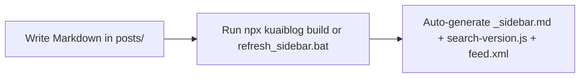

# Welcome to KuaiBlog

> **KuaiBlog** is a zero-build-step Markdown blog and knowledge-base engine built on Docsify with **Geek Dark** & **Pastel Light** dual themes, IDE-grade syntax highlighting, MathJax LaTeX, Mermaid 12 diagrams, APlayer/DPlayer media tags, and automatic search cache invalidation.

## 1. Switching Themes

- **Click** the floating circle button at the bottom-right corner to toggle the sidebar.
- **Long-press (hold for 0.5s)** the bottom-right floating circle button to switch between **Geek Dark** (`dark`) and **Pastel Aurora** (`light`) themes.

## 2. IDE-Grade Syntax Highlighting

```go
package main

import "fmt"

func main() {
    for i := 0; i < 3; i++ {
        fmt.Println("Hello, KuaiBlog!")
    }
}
```

## 3. Mathematics & Diagrams

Inline Euler's identity $e^{i\pi} + 1 = 0$ and display math:

$$
\int_{-\infty}^{\infty} e^{-x^2} \, dx = \sqrt{\pi}
$$



## 4. Custom Audio & Video Tags

Embed audio or video players anywhere in Markdown:

- Audio tag syntax: ``@[audio](url, title, artist, cover)``
- Video tag syntax: ``@[video](url)``

## 5. Responsive Tables

| Feature | Syntax / Trigger | Description |
| :--- | :--- | :--- |
| Theme Toggle | Long-press bottom-right button (500ms) | Switches Geek Dark and Pastel Light themes |
| CRT Reboot | Click sidebar top heading | Plays CRT turn-off/on effect |
| Image Lightbox | Click any article image | Opens Viewer.js zoomable gallery |
| Folder Lock | Configure `auth` in `kuaiblog.config.js` | Protects private directories with a password |
